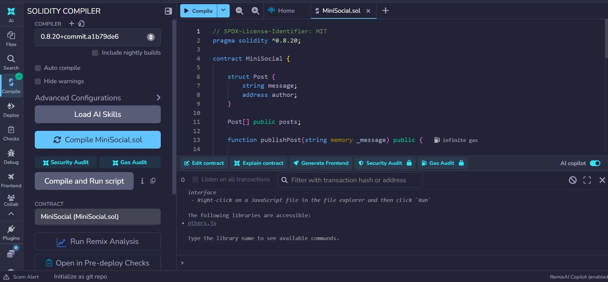
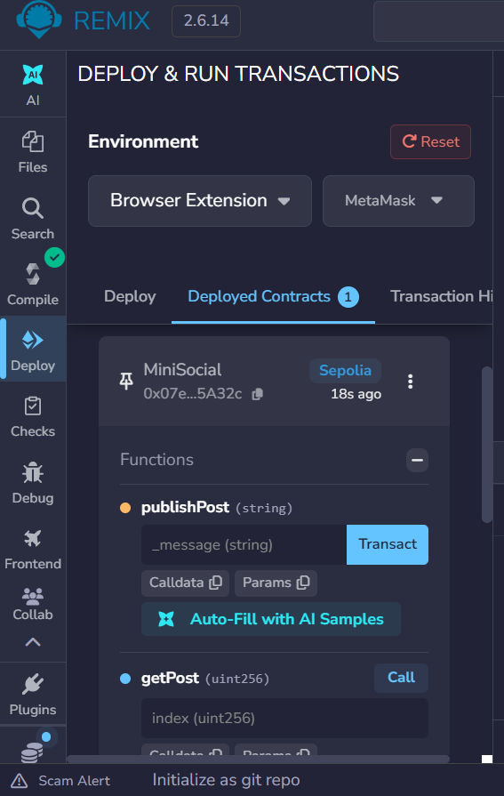
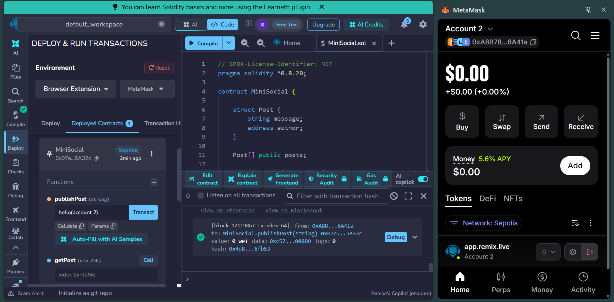
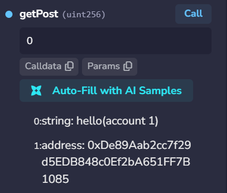
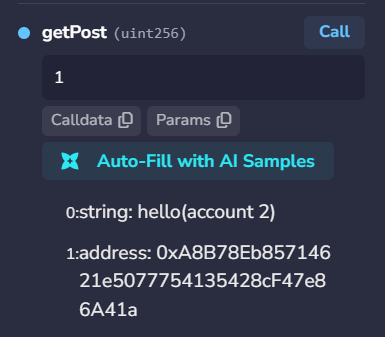

# MiniSocial — Decentralized Social Network

## 1. Project Overview

**MiniSocial** is a simple decentralized social network developed using Solidity and deployed on the Ethereum Sepolia test network.

The application allows users to publish messages directly on the blockchain. Each publication is associated with the Ethereum wallet address of its author. Users can also retrieve previously published messages and check the total number of publications.

The project was developed as part of **Atelier 3: Smart Contract Mini Réseau Social**.

## 2. Project Objectives

- Understand the fundamentals of blockchain development.
- Learn Solidity smart contract programming.
- Define and use structures (`struct`).
- Store data using dynamic arrays.
- Publish messages on a blockchain.
- Identify authors through Ethereum wallet addresses.
- Deploy a smart contract using Remix IDE.
- Interact with the contract using MetaMask.
- Test the application using different accounts.

## 3. Technologies Used

| Technology | Description |
|---|---|
| Solidity | Smart contract programming language |
| Remix IDE | Smart contract development and deployment |
| MetaMask | Ethereum wallet |
| Ethereum Sepolia | Blockchain test network |
| GitHub | Source code hosting and documentation |

## 4. Smart Contract Architecture

The MiniSocial smart contract contains:

- A `Post` structure.
- A dynamic array named `posts`.
- A function to publish messages.
- A function to retrieve messages.
- A function to count publications.

### 4.1 Post Structure

```solidity
struct Post {
    string message;
    address author;
}
```

The structure contains:

- `message`: The text of the publication.
- `author`: The Ethereum address of the user who published it.

### 4.2 Dynamic Array

```solidity
Post[] public posts;
```

This array stores all publications.

Each publication is associated with an index:

| Index | Publication |
|---|---|
| 0 | First publication |
| 1 | Second publication |
| 2 | Third publication |

The `public` keyword automatically provides a getter for accessing the array elements.

## 5. Complete Smart Contract Code

```solidity
// SPDX-License-Identifier: MIT
pragma solidity ^0.8.20;

contract MiniSocial {

    struct Post {
        string message;
        address author;
    }

    Post[] public posts;

    function publishPost(string memory _message) public {
        Post memory newPost = Post({
            message: _message,
            author: msg.sender
        });

        posts.push(newPost);
    }

    function getPost(uint index)
        public
        view
        returns (string memory, address)
    {
        Post memory post = posts[index];
        return (post.message, post.author);
    }

    function getTotalPosts() public view returns (uint) {
        return posts.length;
    }
}
```

## 6. Function Explanations

### 6.1 publishPost()

```solidity
function publishPost(string memory _message) public {
    Post memory newPost = Post({
        message: _message,
        author: msg.sender
    });

    posts.push(newPost);
}
```

This function publishes a new message.

Steps:

1. The user provides a message.
2. A new `Post` structure is created.
3. The message is stored in the `message` attribute.
4. `msg.sender` records the wallet address of the user.
5. `posts.push()` adds the publication to the array.

### 6.2 getPost()

```solidity
function getPost(uint index)
    public
    view
    returns (string memory, address)
{
    Post memory post = posts[index];
    return (post.message, post.author);
}
```

This function retrieves a publication by its index.

It returns:

- The message.
- The author's wallet address.

The `view` keyword means the function reads blockchain data without modifying it.

### 6.3 getTotalPosts()

```solidity
function getTotalPosts() public view returns (uint) {
    return posts.length;
}
```

This function returns the total number of publications stored in the array.

For example, if two messages have been published, the function returns `2`.

## 7. Compilation

The smart contract was compiled using Remix IDE with Solidity version 0.8.20 or a compatible compiler.

The compilation process verifies that the Solidity code is syntactically correct and generates the contract's bytecode.

### Compilation Screenshot



## 8. Deployment

The contract was deployed on the Ethereum Sepolia test network using Remix IDE and MetaMask.

Deployment procedure:

1. Open Remix IDE.
2. Compile `MiniSocial.sol`.
3. Connect MetaMask to Ethereum Sepolia.
4. Select `Injected Provider - MetaMask`.
5. Select the `MiniSocial` contract.
6. Click **Deploy**.
7. Confirm the transaction in MetaMask.

After deployment, the contract becomes accessible through its blockchain address.

### Deployment Screenshot



### Network Information

| Parameter | Value |
|---|---|
| Network | Ethereum Sepolia |
| Chain ID | 11155111 |
| Currency | SepoliaETH |
| Explorer | [Sepolia Etherscan](https://sepolia.etherscan.io/) |

## 9. Testing and Results

The smart contract was tested using two Ethereum accounts.

### 9.1 Publication from Account 1

Account 1 published the following message:

`Hello everyone! Welcome to MiniSocial.`

The transaction was confirmed using MetaMask.


### 9.2 Publication from Account 2

Account 2 published the following message:

`Welcome to our decentralized social network!`

The contract records the second author's wallet address.



### 9.3 Retrieving the First Publication

The function `getPost(0)` was executed to retrieve the first publication.

Expected result:

- First message.
- Account 1 wallet address.



### 9.4 Retrieving the Second Publication

The function `getPost(1)` was executed to retrieve the second publication.

Expected result:

- Second message.
- Account 2 wallet address.



### 9.5 Counting Publications

The function `getTotalPosts()` was executed.

Expected result after two successful publications:

```text
2
```


### 9.6 Test Summary

| Test | Function | Expected Result |
|---|---|---|
| Publish message from Account 1 | `publishPost()` | First publication created |
| Publish message from Account 2 | `publishPost()` | Second publication created |
| Retrieve first publication | `getPost(0)` | First message and author |
| Retrieve second publication | `getPost(1)` | Second message and author |
| Count publications | `getTotalPosts()` | 2 |

*The screenshots above should be replaced by the actual screenshots from your Remix IDE session.*

## 10. Blockchain Transaction Process

When a user publishes a message, the following process takes place:

1. The user calls `publishPost()`.
2. MetaMask requests transaction authorization.
3. The user confirms the transaction.
4. The transaction is transmitted to Ethereum Sepolia.
5. Validators process the transaction.
6. The smart contract executes the function.
7. The publication is stored in the contract's state.

Publishing messages requires SepoliaETH to pay gas fees.

Read-only operations using `view` functions do not require a transaction when called locally as a read operation.

## 11. Advantages

- **Decentralization:** Publications are stored in a blockchain smart contract.
- **Transparency:** Publications can be inspected on the blockchain.
- **Traceability:** Each publication has an associated author address.
- **Persistence:** Stored publications remain in the contract's state.
- **Public accessibility:** Anyone can read the publications.
- **Automation:** Smart contract functions execute according to their defined logic.

## 12. Limitations

The current project is an educational prototype.

It does not include:

- User profiles.
- Message editing or deletion.
- Likes or comments.
- Private messaging.
- A graphical frontend.
- Content moderation.
- Pagination.
- Message length restrictions.

All messages and author addresses are publicly accessible on the blockchain. Users should not publish confidential information.

## 13. Future Improvements

Possible improvements include:

1. Add user profiles linked to Ethereum addresses.
2. Implement likes and comments.
3. Add timestamps to publications.
4. Develop a frontend using React or Next.js.
5. Connect the frontend using Ethers.js or Viem.
6. Add Solidity events for new publications.
7. Implement pagination.
8. Introduce content moderation mechanisms.

## 14. Project Structure

```text
MiniSocial-Smart-Contract/
│
├── contracts/
│   └── MiniSocial.sol
│
├── screenshots/
│   ├── compilation.png
│   ├── deployment.png
│   ├── account1-publication.png
│   ├── account2-publication.png
│   ├── first-post.png
│   ├── second-post.png
│   └── total-posts.png
│
└── README.md
```

## 15. Conclusion

The MiniSocial project provides a practical introduction to smart contract development using Solidity and Ethereum.

Through this project, we learned how to define structures, store data using dynamic arrays, create functions that modify blockchain state, and retrieve stored information.

We also learned how to compile and deploy a smart contract using Remix IDE, connect an Ethereum wallet through MetaMask, and test the application on the Sepolia test network.

MiniSocial demonstrates how blockchain technology can be used to develop decentralized applications where publications are publicly accessible and associated with their authors' wallet addresses.

This project represents a first step toward understanding the development of decentralized applications (DApps) on Ethereum.
